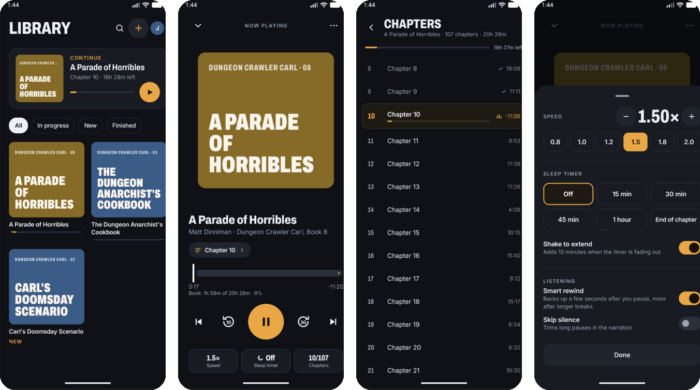

<p align="center">
  
</p>

<h1 align="center">Book Driver</h1>

<p align="center">
  <b>Your audiobooks, streamed straight from your own Google Drive.</b><br>
  A free, open-source Android audiobook player. No uploading, no syncing, no server, no account but your own.
</p>

<p align="center">
  <a href="LICENSE"></a>
  
  
  
</p>

<p align="center">
  
</p>

---

You already keep your audiobooks in Google Drive. Book Driver plays them where they are: sign in with your Google account, pick the books, and listen. It reads chapters, covers and durations straight out of the files without downloading them, streams the audio with seeking, and remembers where you are on every device.

## Features

- **Streams from Drive.** Instant seeking with HTTP Range requests, plus a local cache so rewinds and re-opens don't download again.
- **Real chapters.** Read straight from `.m4b` / `.m4a` files (Nero `chpl` and QuickTime chapter tracks) without downloading the audio. A folder of MP3s becomes one book with a chapter per file, in natural order (`Chapter 2` before `Chapter 10`).
- **Covers and tags** come from the files (MP4 `ilst`, ID3v2). Books without art get a generated typographic cover.
- **Remembers your place.** Positions are saved on the phone and mirrored to a hidden app folder in *your* Drive, so they survive reinstalls and follow you to a new phone.
- **A proper player.** Back 10 s / forward 30 s, previous / next chapter, 0.5–3× speed with pitch correction, skip silence, and smart rewind (backs up a few seconds after a pause, more after a long break).
- **Sleep timer.** 15 / 30 / 45 / 60 minutes or end of chapter. It only counts while playing, fades out over the last 10 seconds, and shaking the phone in the last minute adds 10 more.
- **Background playback** with notification and lock-screen controls, Bluetooth and headset buttons (next/previous jump chapters), and playback resumption.

## Privacy

Book Driver asks for two narrow Google permissions and nothing else:

| Scope | What it allows |
|---|---|
| `drive.file` | Only the files **you pick** in the Drive picker. The app can't see anything else in your Drive. |
| `drive.appdata` | A hidden folder only this app can read, used for your listening progress. |

There is no Book Driver server and no analytics. Your Drive talks to your phone, that's it.

## Adding books

Tap **+** and pick files in the Google Drive picker.

- **An `.m4b` file:** tap it. Each `.m4b` becomes its own book.
- **A folder of chapter files:** open the folder, long-press the first file, then tap the rest. Files picked from the same folder become one book.

> [!NOTE]
> Picking a *folder* doesn't work. Google's `drive.file` permission shares the folder itself but not what's inside it, so pick the files.

## Status

Book Driver works end to end: importing, streaming, chapters, speed, sleep timer and progress sync have all been exercised on real 10–20 hour books. It isn't on the Play Store yet, so for now you build it yourself (below).

Not verified yet: lock-screen and notification controls on a real phone, Android Auto. Not built yet: offline downloads.

## Building it yourself

Because Google matches Android sign-in to an app's package name and signing key, each build needs a matching OAuth client in a Google Cloud project. No client ID or secret goes in the code. One-time setup:

1. **Create a Google Cloud project** at [console.cloud.google.com](https://console.cloud.google.com).
2. **Enable APIs:** Google Drive API and Google Picker API.
3. **Google Auth Platform:**
   - *Branding:* app name and support email.
   - *Audience:* External. Use **Testing** and add yourself as a test user, or **In production** to let anyone sign in.
   - *Data access:* add `.../auth/drive.file` and `.../auth/drive.appdata`. Both are non-sensitive, so no Google verification is needed.
4. **Create an Android OAuth client** (*Clients → Create client → Android*):
   - Package name: `se.jferm.bookdriver` (or your own `applicationId` if you fork).
   - SHA-1: from `./gradlew signingReport`. Debug builds use `keystore/debug.keystore` if it exists (it's gitignored), otherwise your usual `~/.android/debug.keystore`.
5. **Open the project in Android Studio** and run it on a device or an emulator image that includes Google Play.

Requirements: a recent Android Studio (its bundled JDK is fine) and Android SDK 37. The app runs on Android 8.0 (API 26) and up.

### Publishing a fork

- Add a **second** Android OAuth client with the *App signing key* SHA-1 from Play Console → *Test and release → App integrity*.
- Switch the consent screen's audience to **In production**.
- Store icon and logo files are in [`branding/`](branding).

### Troubleshooting

- **`UNREGISTERED_ON_API_CONSOLE` / developer error 10:** the installed app's signing SHA-1 doesn't match any Android client. *Settings → Copy diagnostics log* shows the SHA-1 the app is actually signed with. If you changed signing keys, uninstall the app once: Android Studio's fast deploy keeps the old signature.
- **"Access blocked: … is being tested":** the consent screen is in Testing and that Google account isn't a test user.
- **A book shows the wrong title or no chapters:** long-press it, choose *Remove from library*, and add it again. A book that failed to import offers *Try reading it again* in the same menu. Still wrong? Open an issue with the diagnostics log.

## How it works

| Package | What's in it |
|---|---|
| `auth` | Google Identity `AuthorizationClient` sign-in, the Drive picker request, token caching and refresh |
| `drive` | Drive REST over OkHttp (`DriveApi`), a 401-retrying auth client, `BookImporter`, `ProgressSync` |
| `media` | `RangeSource` (block-cached range reads), `Mp4Parser` (boxes, chapters, tags, cover), `Mp3Probe` (ID3, Xing/VBRI/CBR duration) |
| `data` | `Book` / `Track` / `Chapter` / `Progress` models, the JSON-backed `LibraryRepository`, `Settings` |
| `playback` | `PlaybackService` (Media3 `MediaLibraryService`), `BookPlayer` (chapter navigation, smart rewind), `SleepTimer`, the cached ExoPlayer |
| `ui` | Jetpack Compose screens: Welcome, Library, Player, Chapters, Add book, and the speed/sleep and settings sheets |

Importing a book never downloads the audio. The parsers read only the bytes they need through range requests: for a 1 GB `.m4b` that's usually the header and the `moov` box, a few hundred KB to a few MB.

Stack: Kotlin, Jetpack Compose, Media3 (ExoPlayer, session, cache), OkHttp, Google Identity (Play services), kotlinx.serialization. There's no Google API client library; Drive is plain REST.

## Tests

```sh
./gradlew testDebugUnitTest
```

Parser tests run against small ffmpeg-made fixtures in `app/src/test/resources`: Nero and QuickTime chapters, a `moov` box at the end of the file, tags and cover art, and MP3 durations with and without a Xing header.

## Contributing

Issues and pull requests are welcome. If something doesn't play or import right, the diagnostics log (*Settings → Copy diagnostics log*) is the most useful thing to attach. It never contains full access tokens, but check it for file names you'd rather not share.

## License

- Code: [Apache License 2.0](LICENSE)
- Fonts: [Archivo](https://github.com/Omnibus-Type/Archivo) and [Inter](https://github.com/rsms/inter), under the SIL Open Font License ([`licenses/`](licenses))
